<p align="center">
  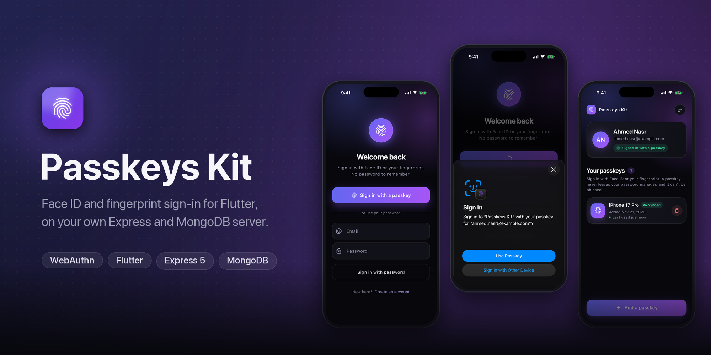
</p>

<p align="center">
  <a href="https://github.com/A7medking1/passkeys-kit/actions/workflows/ci.yml"></a>
  <a href="LICENSE"></a>
  
  
  
  
  
</p>

# Passkeys Kit

**Let your users sign in with Face ID or a fingerprint, with no password, in a Flutter app backed by your own Express and MongoDB server.**

Passkeys Kit is two small pieces that fit together, plus an example of both:

- **[`server/`](server)**: an Express 5 router and two MongoDB models that do the WebAuthn work: options, single-use challenges, verification, and each user's list of passkeys. It plugs into the users and sessions you already have instead of replacing them.
- **[`flutter/`](flutter)**: `passkeys_kit`, a Dart package that shows the system passkey sheet on iOS and Android and talks to that router. You call `signIn()`, `register()`, `list()` and `delete()`.
- **[`flutter/example/`](flutter/example)** and **[`server/example/`](server/example)**: a complete app and API with password accounts and passkeys on top. It's the app in the screenshots below.

## Screenshots

These are real screenshots of the example app on an iPhone 17 Pro Simulator (iOS 26.5). The passkey is a real one: iOS saved it in the Simulator's Passwords app, and the example server verified every signature.

<table>
  <tr>
    <td align="center" width="33%">
      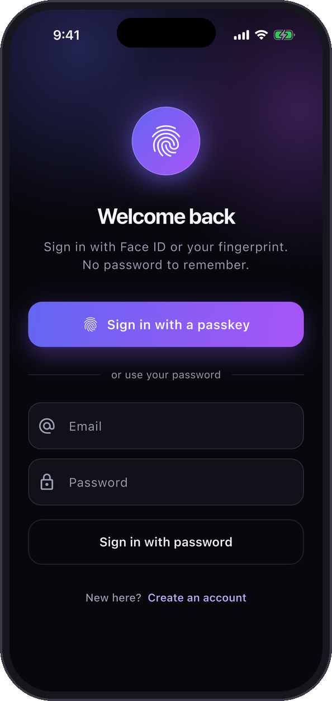<br>
      <sub><b>Sign in</b><br>The passkey first, the password as a fallback</sub>
    </td>
    <td align="center" width="33%">
      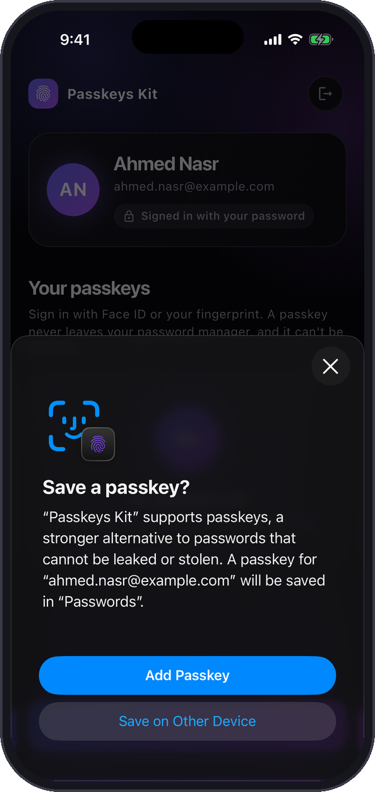<br>
      <sub><b>Add a passkey</b><br>The system sheet, then Face ID</sub>
    </td>
    <td align="center" width="33%">
      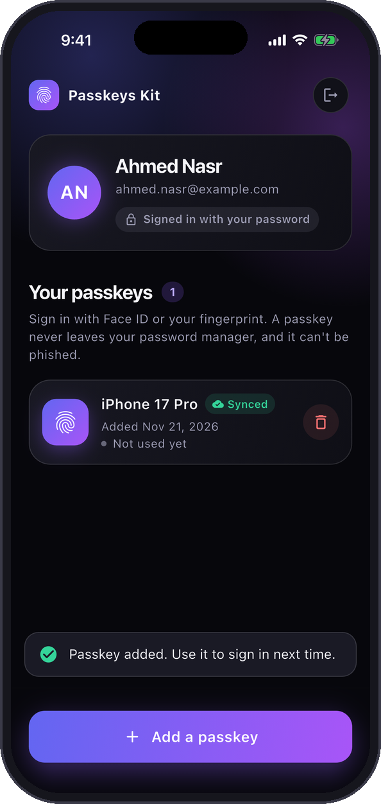<br>
      <sub><b>Saved</b><br>Named after the phone, synced by iCloud Keychain</sub>
    </td>
  </tr>
  <tr>
    <td align="center">
      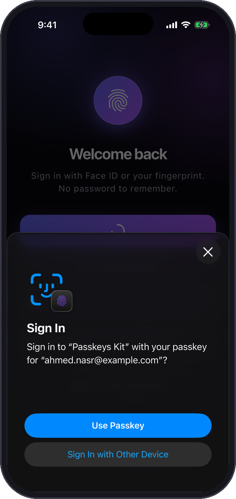<br>
      <sub><b>Sign in with it</b><br>No email and no password to type</sub>
    </td>
    <td align="center">
      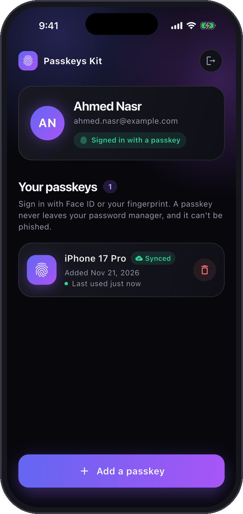<br>
      <sub><b>Signed in</b><br>The same session a password sign-in gets</sub>
    </td>
    <td align="center">
      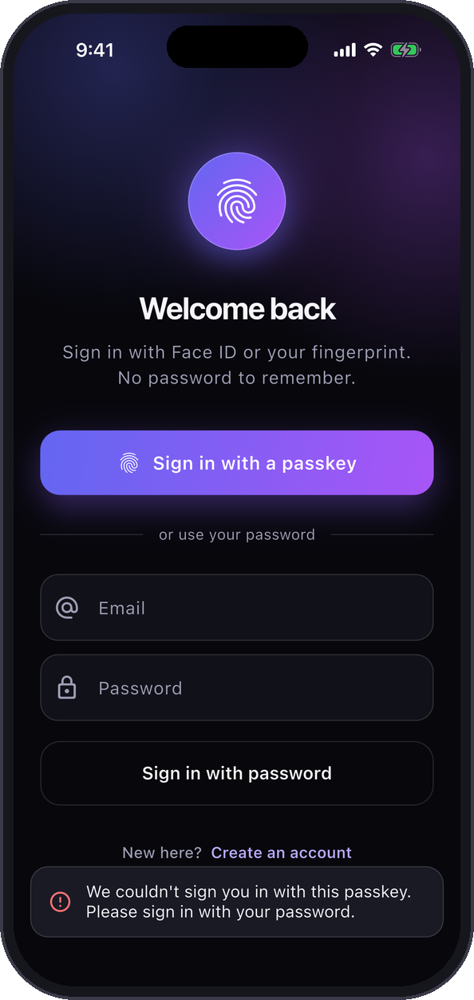<br>
      <sub><b>Deleted means deleted</b><br>The server refuses a passkey you removed</sub>
    </td>
  </tr>
</table>

<details>
<summary>The other three screens</summary>
<br>
<table>
  <tr>
    <td align="center" width="33%">
      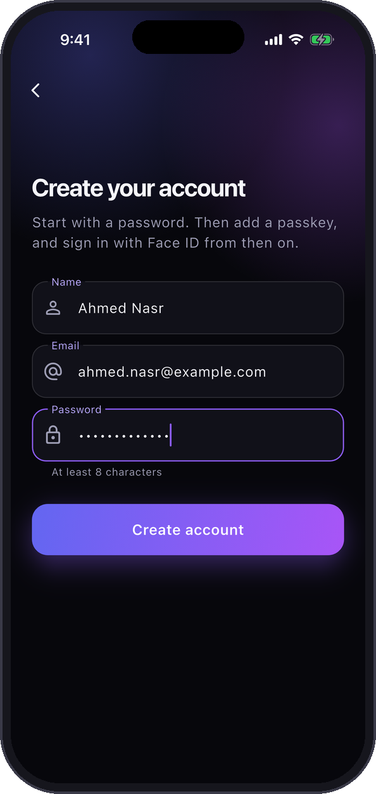<br>
      <sub><b>Sign up</b><br>A normal account with a password</sub>
    </td>
    <td align="center" width="33%">
      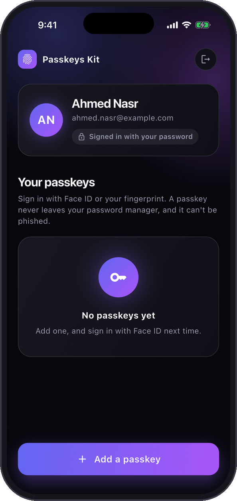<br>
      <sub><b>No passkeys yet</b><br>Signed in with the password</sub>
    </td>
    <td align="center" width="33%">
      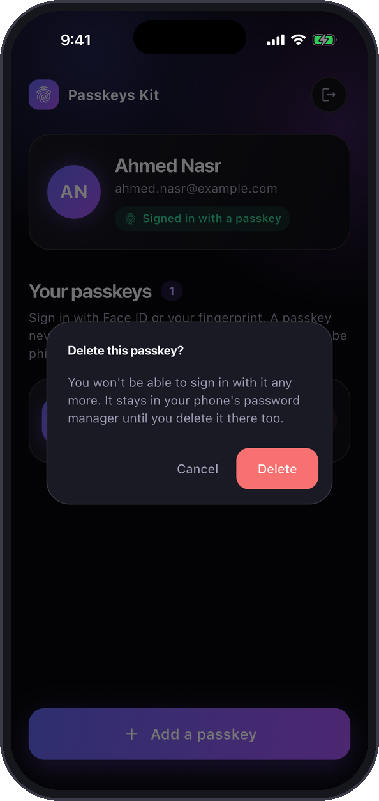<br>
      <sub><b>Delete</b><br>It stops working on the server at once</sub>
    </td>
  </tr>
</table>
</details>

## Features

- **Usernameless sign-in.** One tap shows every passkey the phone has for your app. There's no email field to fill.
- **Your users, your sessions.** The kit never touches your user model and never issues tokens. A `signIn` hook returns the same body your password sign-in returns, so the app saves it the same way.
- **iOS and Android from one server.** It works with iCloud Keychain and Google Password Manager, and works out the Android origins (`android:apk-key-hash:…`) from the signing-key fingerprints you already have.
- **Single-use challenges in MongoDB.** Each challenge is saved with a TTL index and taken back with one `findOneAndDelete`. It can't be replayed, and it works with any number of server instances, serverless included.
- **Safe defaults.** User verification is required. Every failed sign-in gets the same 401, so nobody can probe for accounts. The public routes are rate limited, and public keys never leave the server.
- **The `.well-known` files.** `apple-app-site-association` and `assetlinks.json` come from the same config. Serve them with the kit, or merge them into the files you already have.
- **Translatable.** You can replace every server message and every client error.
- **Tested without mocks.** The server tests sign with a real P-256 virtual authenticator, and SimpleWebAuthn checks every signature for real. The flow in the screenshots was run end to end on the iOS Simulator.

## How it works

A passkey is a key pair made for one account on one domain. The private key stays in the phone's password manager (iCloud Keychain or Google Password Manager) and only signs after Face ID or a fingerprint. Your server keeps the public key and checks every signature with it.

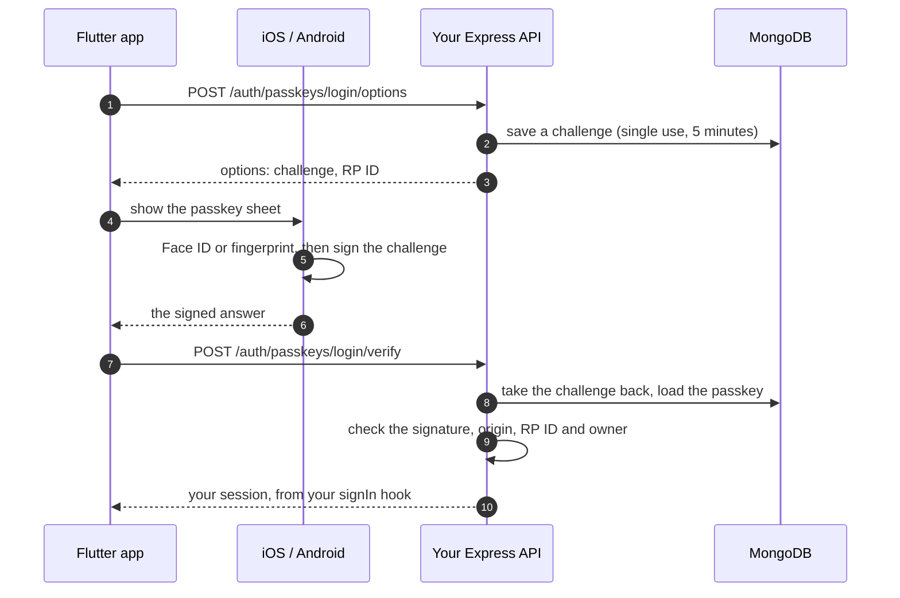

Adding a passkey works the same way with `register/options` and `register/verify`, for a user who is already signed in. [How it works](docs/how-it-works.md) walks through both flows and what gets stored where.

## Quick start: run the example

You need Node.js 22.9 or newer (24 LTS recommended), MongoDB, Flutter 3.41 or newer, and Xcode for the iOS Simulator or Android Studio for an emulator.

> [!IMPORTANT]
> Every passkey belongs to a domain, called the **RP ID**. A phone only lets your app use that domain's passkeys if the domain lists the app in its `.well-known` files, over HTTPS. Your API can run anywhere, even on `localhost`, but the RP ID must be a real domain you control. Set it up first with the [domain setup guide](docs/domain-setup.md). It takes about ten minutes.

**1. Start the server**

```bash
cd server
cp .env.example .env     # set RP_ID, IOS_APP_IDS, ANDROID_PACKAGE and ANDROID_SHA256
npm install
npm run dev              # http://localhost:3000
```

**2. Run the app**

```bash
cd flutter/example
cp ios/Flutter/Local.xcconfig.example ios/Flutter/Local.xcconfig   # your bundle id, team id and RP ID
flutter run
```

**3. Try it.** Create an account, tap **Add a passkey**, sign out, then tap **Sign in with a passkey**.

On the iOS Simulator, turn on **Features → Face ID → Enrolled** first, then use **Features → Face ID → Matching Face** when the sheet asks. The [example's README](flutter/example/README.md) has the full walkthrough, including Android.

## Add it to your app

### Server

The server package isn't on npm yet. Copy [`server/src/`](server/src) into your backend (as `src/passkeys/`, say) and install what it uses. Your app provides Express 5 and Mongoose 9.

```bash
npm install @simplewebauthn/server@^14 express-rate-limit@^8 zod@^4
```

Then mount the router next to your password sign-in:

```ts
import { createPasskeys, passkeyOrigins } from "./passkeys/index.js";

const passkeys = createPasskeys<UserDocument>({
  config: {
    rpID: "example.com",
    rpName: "Example",
    origins: passkeyOrigins({
      rpID: "example.com",
      // The SHA-256 of every key that signs your Android app.
      androidSha256: ["F7:74:7B:3A:…:75:C9"],
    }),
  },
  // How the kit reads your users. Your user model stays yours.
  users: {
    id: (user) => user.id,
    name: (user) => user.email,
    displayName: (user) => user.name,
    findById: (id) => User.findById(id).exec(),
  },
  authenticate: requireAuth,                  // your auth middleware
  currentUser: (_req, res) => res.locals.user, // the user it attached
  signIn: (user) => createSession(user),       // the same body as POST /auth/login
});

app.use("/auth/passkeys", passkeys.router);
```

When a user changes their password, call `passkeys.removeAll(user.id)` along with ending their other sessions. The [server guide](docs/server.md) has every option.

### Flutter

The package isn't on pub.dev yet. Add it from this repository:

```yaml
dependencies:
  passkeys_kit:
    git:
      url: https://github.com/A7medking1/passkeys-kit.git
      path: flutter
```

```dart
import 'package:passkeys_kit/passkeys_kit.dart';

final passkeys = PasskeyClient(
  server: DioPasskeyServerApi(
    baseUrl: Uri.parse('https://api.example.com/auth/passkeys'),
    headers: () async => {'Authorization': 'Bearer ${await tokens.read()}'},
  ),
);

// Sign-in screen: show the button only where passkeys work.
if (await passkeys.isAvailable()) {
  try {
    final session = await passkeys.signIn(); // what your signIn hook returned
    await saveSession(session);
  } on PasskeyException catch (error) {
    if (!error.isCancelled) showError(error.message);
  }
}

// Settings, once signed in.
await passkeys.register();               // named after the phone: "iPhone 17 Pro"
final list = await passkeys.list();      // the newest first
await passkeys.delete(list.first.id);
```

Your app also needs the iOS entitlement and the Android signing keys in place. The [Flutter guide](docs/flutter.md) covers both.

## Documentation

| Guide | What's in it |
| --- | --- |
| [How it works](docs/how-it-works.md) | Passkeys in five minutes, both flows step by step, and what's stored where |
| [Domain setup](docs/domain-setup.md) | The RP ID, `apple-app-site-association`, `assetlinks.json`, the iOS entitlement, Android signing keys, and how to check them |
| [Server guide](docs/server.md) | Every option, route, hook and message of the Express router |
| [Flutter guide](docs/flutter.md) | `PasskeyClient`, errors, platform setup, and using your app's Dio |
| [Testing](docs/testing.md) | The test suites, the virtual authenticator, and driving Face ID on the Simulator |
| [Troubleshooting](docs/troubleshooting.md) | The errors you'll meet, and what fixes them |
| [Security](docs/security.md) | What the kit checks, why, and what stays your job |

## Requirements

| | Minimum | Notes |
| --- | --- | --- |
| iOS | 16 | Passkeys need iOS 16. The example still builds for iOS 15 and hides its passkey buttons there. |
| Android | 9 (API 28) | With Google Play services, a Google account and a screen lock |
| Flutter | 3.41 (Dart 3.11) | |
| Node.js | 22.9 | 24 LTS recommended |
| Express | 5 | The router relies on Express 5 sending rejected promises to error handlers |
| Mongoose | 9 | MongoDB 9 was used for the tests |

## Project layout

```text
passkeys-kit/
├── server/              Express 5 and MongoDB, in TypeScript
│   ├── src/             the kit: router, service, models, .well-known files
│   ├── example/         a whole API: accounts, sessions, and passkeys
│   └── tests/           29 tests, signed by a virtual authenticator
├── flutter/             the passkeys_kit package
│   ├── lib/             PasskeyClient, DioPasskeyServerApi, PasskeyException
│   ├── test/            15 tests
│   └── example/         the app in the screenshots
└── docs/                the guides above
```

## Status

Version 0.1.0. The whole flow was run on the iOS Simulator, with a real passkey and the example server. The Android side follows Google's Credential Manager setup, and the server's Android origins are covered by tests, but this release hasn't been run on an Android device yet. Reports are welcome.

## Contributing

Issues and pull requests are welcome. [CONTRIBUTING.md](CONTRIBUTING.md) explains how to run everything and what a change needs. Please report security problems privately, as [SECURITY.md](SECURITY.md) describes.

## License

[MIT](LICENSE)
