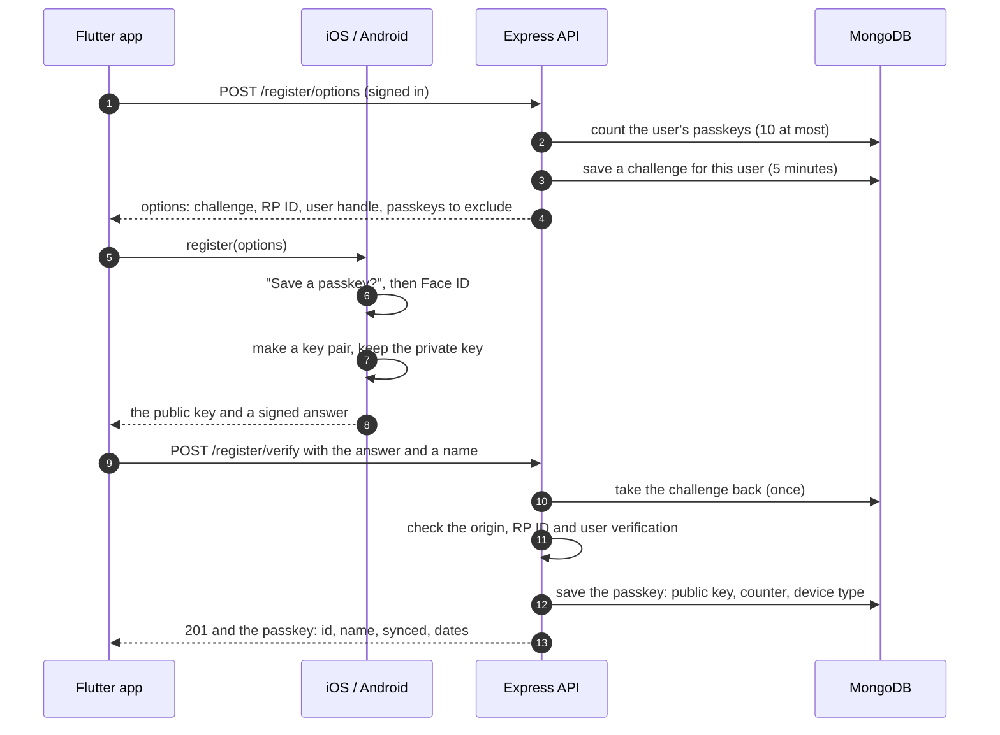
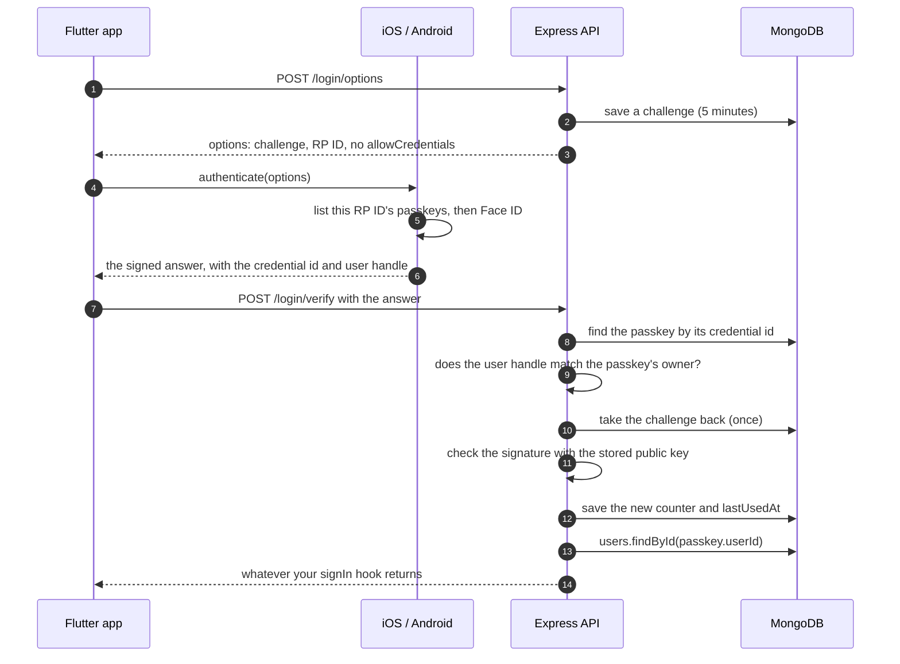

# How it works

This guide explains passkeys only as far as the kit needs, then follows both flows through the kit step by step.

- [Passkeys in five minutes](#passkeys-in-five-minutes)
- [Adding a passkey](#adding-a-passkey)
- [Signing in with a passkey](#signing-in-with-a-passkey)
- [What's stored where](#whats-stored-where)
- [How a phone knows your app may use the passkeys](#how-a-phone-knows-your-app-may-use-the-passkeys)
- [The choices the kit makes](#the-choices-the-kit-makes)

## Passkeys in five minutes

A passkey is a key pair made for **one account** on **one domain**:

- The **private key** never leaves the phone's password manager: iCloud Keychain on iOS, Google Password Manager on Android. Both sync it to the user's other devices. The phone only uses the key after Face ID, a fingerprint, or the device passcode.
- The **public key** goes to your server, which uses it to check signatures.

Signing in means the server sends a random **challenge**, the phone signs it with the private key, and the server checks the signature with the public key. Nothing secret crosses the network, nothing reusable is stored on the server, and a phishing site can't ask for the signature, because the passkey only works for its own domain.

That domain is the **RP ID** (Relying Party ID), like `example.com`. Every passkey belongs to it for good. Your native app may use the RP ID's passkeys only if the domain says so in its `.well-known` files ([more below](#how-a-phone-knows-your-app-may-use-the-passkeys)).

The standard behind all this is [WebAuthn](https://www.w3.org/TR/webauthn-3/). On the server, the kit uses [SimpleWebAuthn](https://simplewebauthn.dev) for the cryptography. On the phone, `passkeys_kit` uses the [`passkeys`](https://pub.dev/packages/passkeys) package, which calls Apple's AuthenticationServices and Android's Credential Manager.

## Adding a passkey

The user is already signed in, with their password for example, and taps **Add a passkey**:



1. **`register/options`** runs behind your `authenticate` middleware, so only a signed-in user can add a passkey. With `canRegister`, you can narrow it further (customers only, say). The options ask for:
   - a **discoverable** passkey (`residentKey: "required"`), so signing in needs no username;
   - **user verification** (`userVerification: "required"`), so Face ID, a fingerprint or the passcode is always involved;
   - a **platform** authenticator (`authenticatorAttachment: "platform"`): the phone's own password manager, not a USB security key;
   - no attestation (`attestation: "none"`). See [the choices](#the-choices-the-kit-makes) for why.

   The options also list the user's existing passkeys in `excludeCredentials`. A phone that already has one for this account says so instead of making a second one.
2. The **user handle** in the options is your user's id in UTF-8 bytes. It's the same for every passkey of an account, so the phone knows which account a passkey belongs to.
3. The challenge goes to MongoDB with the user's id and an expiry. **`register/verify`** takes it back with one `findOneAndDelete`, so it works exactly once, only for that user, and only before it expires.
4. SimpleWebAuthn checks that the answer was signed for your RP ID, from one of your origins, with user verification. The kit then saves the passkey, named after the phone (`iPhone 17 Pro`) unless the app sends another name.

## Signing in with a passkey

Nobody is signed in. The user taps **Sign in with a passkey**:



1. **`login/options`** is public and rate limited. `allowCredentials` is empty on purpose: the phone offers every passkey it holds for the RP ID, so the user never types an email.
2. The phone answers with the **credential id** (which passkey signed) and the **user handle** (whose passkey it is). The kit finds the passkey by its id and checks that the user handle matches the account it was made for.
3. SimpleWebAuthn checks the signature with the stored public key, along with the challenge, origin, RP ID and user verification. The challenge is taken back exactly once, as in registration.
4. The kit saves the new signature counter and `lastUsedAt`, loads the account with `users.findById`, and hands it to your **`signIn` hook**. Whatever the hook returns becomes the response: in the example, `{ token, user }`, the same body as the password sign-in.

Every failure in steps 2 to 4 (an unknown passkey, a wrong signature, a used or expired challenge, a deleted account) gets the **same 401 and the same message**. The reason goes to your server logs only, so an attacker can't learn which passkeys or accounts exist.

Deleting a passkey on the server doesn't remove it from the phone: the OS doesn't let an app do that. The phone may still offer it, but the server no longer knows it and refuses the sign-in. The last screenshot in the README shows exactly that.

## What's stored where

| Where | What |
| --- | --- |
| The phone's password manager | The private key, the RP ID, the user handle, and the user's name and display name to show in the sheet |
| `passkeys` collection | One document per passkey: the credential id (`_id`), `userId`, the public key, the signature counter, transports, device type, `backedUp`, AAGUID, `name`, `lastUsedAt` and timestamps |
| `passkey_challenges` collection | One document per challenge handed out: `_id` (the challenge), `type`, `userId` (registration only), `expiresAt`. A TTL index deletes them once they expire. |
| Your own collections | Untouched. The kit reads users through your adapter, and the session is yours. |

The API never sends a public key or a counter back. A passkey in a response looks like this:

```json
{
  "id": "hY7m2Q5mH3oN0w2c8f0hYg",
  "name": "iPhone 17 Pro",
  "deviceType": "multiDevice",
  "backedUp": true,
  "createdAt": "2026-11-21T15:44:20.118Z",
  "lastUsedAt": "2026-11-21T15:45:31.902Z"
}
```

`deviceType: "multiDevice"` means the passkey syncs to the user's other devices (the example shows a **Synced** badge). `singleDevice` means it lives on one device only.

## How a phone knows your app may use the passkeys

A website gets its RP ID's passkeys because it's served from that domain. A native app has no domain, so the domain has to vouch for the app:

| | The app says | The domain says | The server sees the origin |
| --- | --- | --- | --- |
| **iOS** | `webcredentials:example.com` in its Associated Domains entitlement | `https://example.com/.well-known/apple-app-site-association` lists `TEAMID.bundle.id` under `webcredentials.apps` | `https://example.com` |
| **Android** | Nothing extra: Credential Manager reads the app's signing key | `https://example.com/.well-known/assetlinks.json` lists the package name and the SHA-256 of its signing key, with `delegate_permission/common.get_login_creds` | `android:apk-key-hash:<base64url SHA-256 of the signing key>` |

The kit covers both ends. `createWellKnownRouter` serves the two files, and `passkeyOrigins` builds the list of origins the server accepts from the same fingerprints. [Domain setup](domain-setup.md) goes through it step by step.

## The choices the kit makes

- **Discoverable passkeys and usernameless sign-in.** It's the smoothest flow: one tap and Face ID, with nothing to type.
- **User verification is required.** A passkey stands in for a password, so the phone must check that its owner is there. A passkey made without verification is refused.
- **Platform authenticators only.** Phones keep passkeys in their own password managers. Without this, iOS also offers a USB security key at registration, which the usernameless sign-in never asks for.
- **No attestation.** Attestation proves which authenticator model made a key. That matters for enterprise policies, but consumer apps don't need it, and synced passkeys mostly don't provide it.
- **Challenges in MongoDB, not in memory.** Any instance can verify a challenge another one handed out, so it works behind a load balancer and on serverless platforms.
- **One user handle per account.** Every passkey of an account carries the same user handle. If a phone still holds a passkey the server has forgotten (one deleted in the app, say), adding a new one replaces it on the phone instead of leaving two.
- **Your sessions stay yours.** The `signIn` hook gives the same answer as your password sign-in: a JWT, a cookie, or whatever you use.
- **A password change removes every passkey.** If someone else knew the old password, they could have added a passkey. `removeAll` makes sure that passkey dies with the password. The example does this in `PUT /auth/password`.

[Security](security.md) goes deeper into each check.
