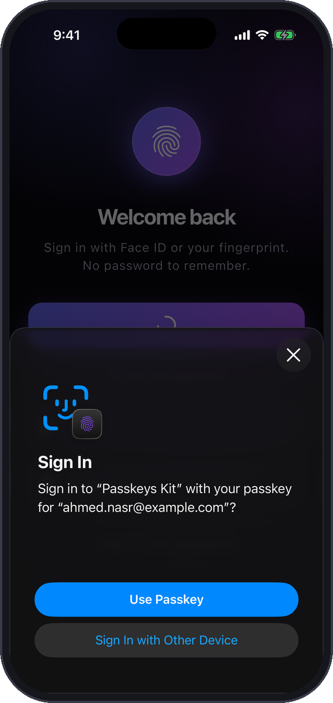
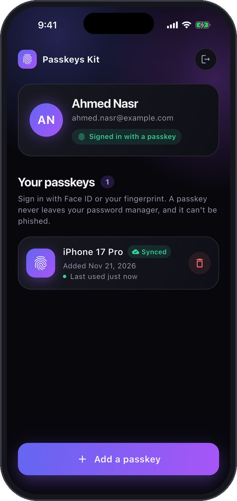

# passkeys_kit

Passkey sign-in for Flutter apps on iOS and Android, with Face ID or a fingerprint. It talks to the [Passkeys Kit server](../server) (Express and MongoDB), and it's part of [Passkeys Kit](../README.md).

<p align="center">
  
  &nbsp;
  
</p>

## Install

```yaml
dependencies:
  passkeys_kit:
    git:
      url: https://github.com/A7medking1/passkeys-kit.git
      path: flutter
```

It needs Flutter 3.41 or newer. Passkeys work on iOS 16+ and on Android 9+ with Google Play services.

## Use

```dart
import 'package:passkeys_kit/passkeys_kit.dart';

final passkeys = PasskeyClient(
  server: HttpPasskeyServerApi(
    baseUrl: Uri.parse('https://api.example.com/auth/passkeys'),
    headers: () async => {'Authorization': 'Bearer ${await tokens.read()}'},
  ),
);

if (await passkeys.isAvailable()) {
  try {
    final session = await passkeys.signIn(); // your server's session
  } on PasskeyException catch (error) {
    if (!error.isCancelled) print(error.message);
  }
}

await passkeys.register();          // signed in: a passkey on this phone
final list = await passkeys.list(); // the newest first
await passkeys.delete(list.first.id);
```

| Call | What it does |
| --- | --- |
| `isAvailable()` | Whether this phone can use passkeys. Hide your passkey buttons when it's false. |
| `signIn()` | Shows the passkey sheet and returns your server's session. The user types nothing. |
| `register({name})` | Makes a passkey on this phone for the signed-in user, named after the phone by default |
| `list()` | The signed-in user's passkeys |
| `delete(id)` | Deletes one on the server |

Every call throws a `PasskeyException` with a `reason` (`cancelled`, `noPasskey`, `server`, `network`, …) and a `message` you can show.

## Set up

The app must be tied to your RP ID's domain:

- **iOS:** the Associated Domains capability with `webcredentials:<RP ID>`, and your App ID in the domain's `apple-app-site-association`.
- **Android:** your package name and signing-key SHA-256 in the domain's `assetlinks.json`, and in the server's origins.

[Domain setup](../docs/domain-setup.md) has the steps.

## More

- [Flutter guide](../docs/flutter.md): errors, your own HTTP client (Dio), tests with fakes, and UX tips
- [Example app](example): the app in the README's screenshots
- [Troubleshooting](../docs/troubleshooting.md)
