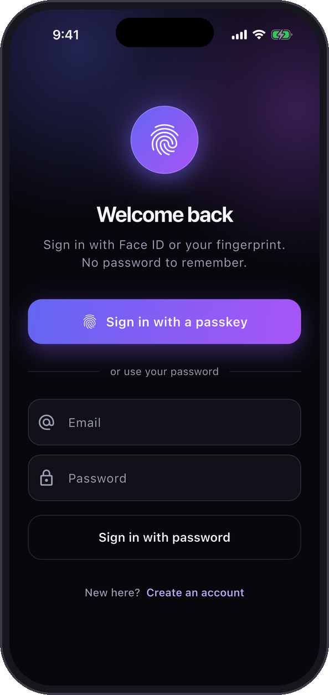
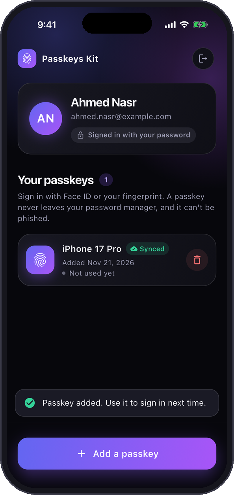
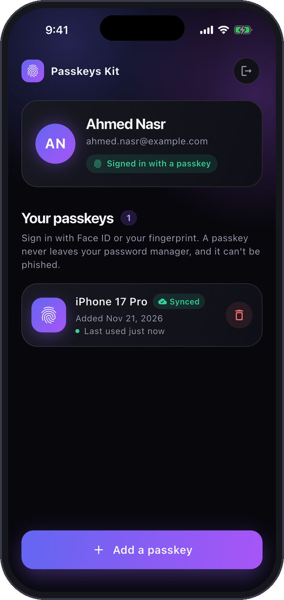

# Passkeys Kit example app

The app in the [README's screenshots](../../README.md#screenshots). It has a dark UI, accounts with a password, and passkeys on top: sign up, add a passkey, sign out, then sign back in with Face ID. It talks to the [example server](../../server/example).

<p align="center">
  
  &nbsp;
  
  &nbsp;
  
</p>

## Before you start

- **The server** is running. See [server/README.md](../../server/README.md).
- **The domain** in the server's `RP_ID` lists this app in its `.well-known` files. See [Domain setup](../../docs/domain-setup.md).
- **Flutter** 3.41 or newer.

## iOS Simulator

1. Copy the config, then set your bundle id, your team (a paid Apple Developer team) and the RP ID:

   ```bash
   cp ios/Flutter/Local.xcconfig.example ios/Flutter/Local.xcconfig
   ```

   ```text
   PASSKEYS_BUNDLE_ID = com.yourcompany.yourapp
   PASSKEYS_TEAM_ID = ABCDE12345
   PASSKEYS_RP_ID = yourdomain.com
   ```

   `Local.xcconfig` is git-ignored. The project reads it after [`Passkeys.xcconfig`](ios/Flutter/Passkeys.xcconfig), which keeps placeholders. The domain's `apple-app-site-association` must list `ABCDE12345.com.yourcompany.yourapp` under `webcredentials`.

2. Run the app on a Simulator:

   ```bash
   flutter run
   ```

3. Enroll Face ID with **Features → Face ID → Enrolled**.
4. Create an account, then tap **Add a passkey**. When the sheet asks for Face ID, use **Features → Face ID → Matching Face**.
5. Sign out, and tap **Sign in with a passkey**.

The Simulator reaches the server at `http://localhost:3000`.

## Android emulator

> [!NOTE]
> This release hasn't been run on Android yet. These steps follow Google's requirements.

1. Use an emulator with a **Google Play** system image. Sign in to a Google account, and set a PIN and a fingerprint.
2. In `server/.env`, set `ANDROID_PACKAGE=com.example.passkeys_kit_example`, and set `ANDROID_SHA256` to your debug key's fingerprint:

   ```bash
   keytool -list -v -keystore ~/.android/debug.keystore -alias androiddebugkey -storepass android -keypass android | grep SHA256
   ```

   The RP ID's `assetlinks.json` must list them too.
3. Run `flutter run`. The emulator reaches the server at `http://10.0.2.2:3000`. To touch the fingerprint sensor, run `adb -e emu finger touch 1`.

## A real phone, or a deployed server

Give the app the server's address:

```bash
flutter run --dart-define=SERVER_URL=https://api.yourdomain.com
```

A phone can't reach your computer's `localhost`. Deploy the server, or expose your local one through a tunnel, such as `cloudflared tunnel --url http://localhost:3000`.

## How the code is organized

| File | What it does |
| --- | --- |
| [`lib/main.dart`](lib/main.dart) | The app: the sign-in screen, or the home screen once signed in |
| [`lib/src/app_state.dart`](lib/src/app_state.dart) | The session, and its two ways in: a password (`signIn`) or a passkey (`signInWithPasskey`). Both end the same way. |
| [`lib/src/account_api.dart`](lib/src/account_api.dart) | The example server's account routes: sign up, sign in, sign out |
| [`lib/src/config.dart`](lib/src/config.dart) | The server URL: `SERVER_URL`, or the default for the Simulator or emulator |
| [`lib/src/screens/`](lib/src/screens) | Sign in, sign up, and home (the account and its passkeys) |
| [`lib/src/widgets/`](lib/src/widgets) | The passkey tile and the shared pieces: background glow, gradient button, glass card |
| [`lib/src/theme.dart`](lib/src/theme.dart) | The dark theme and its palette |
| [`tool/app_icon.py`](tool/app_icon.py) | Draws the app icon in every size. Run `python3 tool/app_icon.py` (needs Pillow). |

## Tests

```bash
flutter test      # signs in with a passkey and adds one, with a fake phone and server
flutter analyze
```
